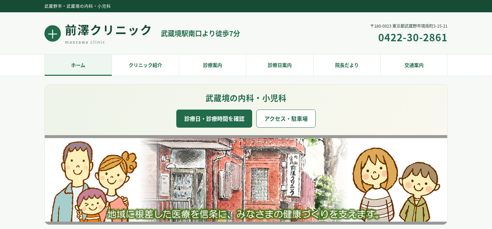
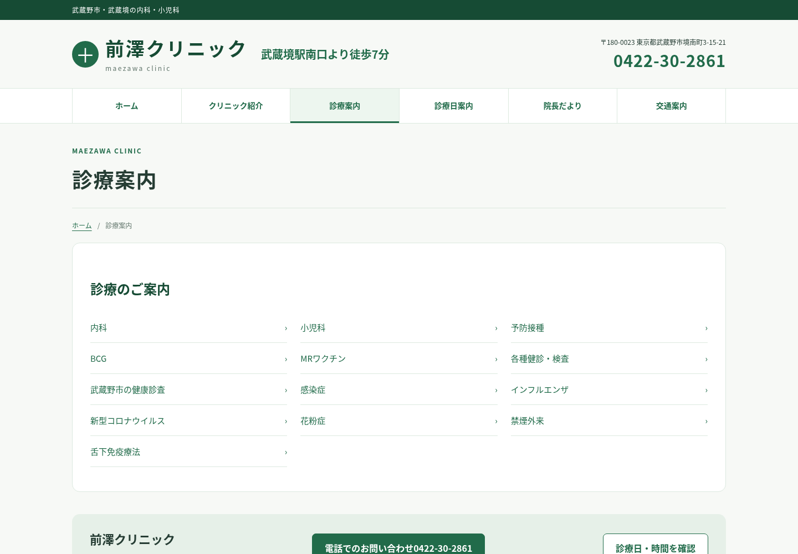
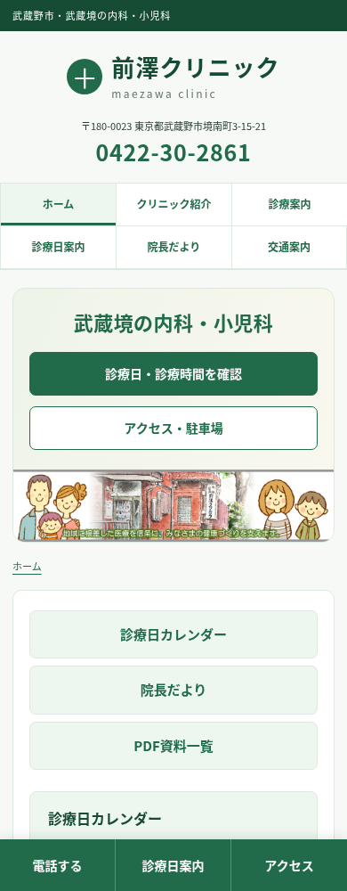
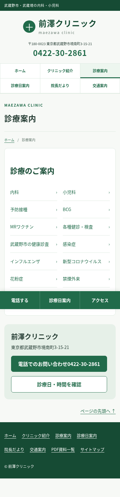

# 前澤クリニック 全ページレスポンシブ対応版

**[最新版ZIPをダウンロード（約42MB）](https://github.com/kanaiyukimi/2026/raw/refs/heads/main/maezawa-responsive-all.zip)**

ZIPをすべて展開し、`maezawa-responsive/index.html` をブラウザで開いてください。

## TOPのみの確認版

トップページだけ、中央揃えと徒歩7分の案内を調整しました。キャッチコピーを削除し、「武蔵境の内科・小児科」と案内ボタンの余白を詰めた確認版です。

[PC確認画像](preview/home-desktop-top-review.png) / [スマホ確認画像](preview/home-mobile-top-review.png)

[TOP差分ZIP](https://github.com/kanaiyukimi/2026/raw/refs/heads/main/top-review.zip) は前回の全ページ版に重ねて確認する2ファイルの差分です。ほかのページと全ページ納品ZIPは変更していません。

## 前回の全ページ版の変更

- トップページのキャッチコピーを削除。h1は「武蔵境の内科・小児科」です。
- スマホのハンバーガーメニューを削除し、グローバルナビを常時表示。
- ナビは「ホーム・クリニック紹介・診療案内・診療日案内・院長だより・交通案内」の6項目。
- 「診療案内」ページを新設。13項目のメニューボタンをPCは3列、スマホは画面幅に応じて2列または1列で表示。
- PDF資料一覧はサイドバーやフッターから利用できます。

## 表示例

 

## 収録内容・確認

提供された全20ページと、診療案内・PDF資料一覧の追加2ページ（合計22ページ）、PDF219点すべてを収録しています。元の本文とPDFの内容を保持しています。

22ページを5つの画面幅で確認（110通り）。横はみ出し、画像読込失敗、JSエラーなし。ローカルリンク・ページ内アンカー・PDF検索を確認し、診療案内の13リンクすべての遷移も確認しました。PDF219点は原本とのSHA-256一致を確認しています。実機Safariや外部サービスの到達性は未検証です。

## 範囲・導入

提供HTMLにない「院内感染対策について」は元サイトへのリンクです。未提供の近隣マップ・駐車場画像も元サイトで開くリンクにしています。住所・アクセス・駐車位置の説明文は収録しています。

静的HTML版です。WordPress管理画面やPHPテーマは含みません。WordPressテーマへそのまま上書きせず、ZIP内の `README.txt` を確認してください。

初回の2ページ版は `maezawa-responsive.zip` に残っています。最新版は **`maezawa-responsive-all.zip`** です。
