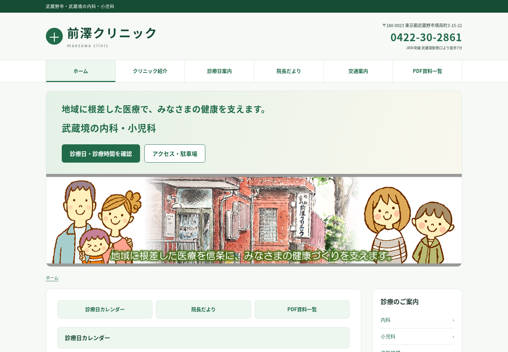
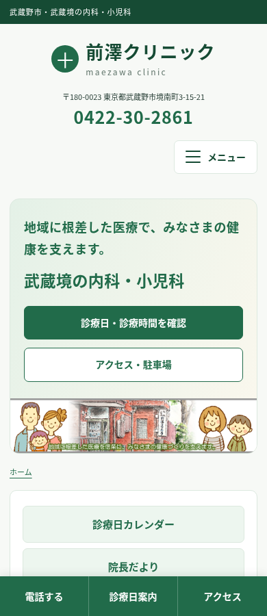
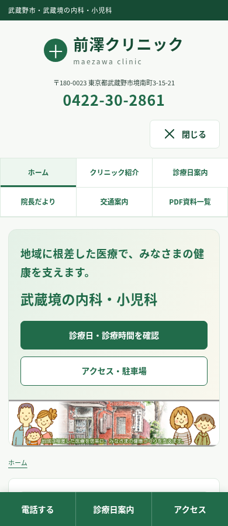

# 前澤クリニック 全ページレスポンシブ対応版

## ダウンロード

**[全ページ版ZIPをダウンロード（約42MB）](https://github.com/kanaiyukimi/2026/raw/refs/heads/main/maezawa-responsive-all.zip)**

ZIPをすべて展開し、`maezawa-responsive/index.html` をブラウザで開いてください。

## 今回の修正

- トップページのh1を「武蔵境の内科・小児科」に変更
- PC版のキャッチコピー・見出し・ボタンを、いただいた見本に合わせてコンパクトに配置
- スマホ（680px以下）にハンバーガーメニューを追加。全ページでグローバルナビを開閉可能
- キーボード操作、Escapeで閉じる動作、PC幅への切り替え、JS無効時のナビ表示も確認

## 収録内容

- ご提供の閲覧用HTML全20ページと、追加のPDF一覧ページ（計21ページ）
- 送付いただいたPDF219点すべて（原本の内容を保持）
- テキストを中心にした共通デザイン、スマホ・タブレット・PCへの対応
- PDF検索、電話ボタン、診療日・アクセス・各診療ページへのメニュー
- 診療時間表の横スクロール

本文を保持し、画像の見出し・メニュー・バナーを読みやすいテキストに変更しました。必要な画像は残しています。

### スマホ表示

メニューを閉じた状態と開いた状態：

 

## 検証

21ページを320・390・768・1024・1440px幅で確認（105通り）。ページ全体の横はみ出し、表示画像の読み込み失敗、JavaScriptエラーなし。ローカルリンク・ページ内アンカー・PDF検索を確認済み。PDF219点の取得と原本とのSHA-256一致を確認しました。

実機Safariと、Googleのカレンダー・地図など外部サービスへの到達性は未検証です。

## 範囲・導入時の注意

提供HTMLにない「院内感染対策について」は元サイトへのリンクです。未提供の近隣マップ・駐車場画像も元サイトで開くリンクに変更しています。住所・アクセス・駐車位置の説明文は収録しています。

静的HTML版です。WordPress管理画面やPHPテーマは含みません。WordPressテーマへそのまま上書きせず、ZIP内の `README.txt` を確認してください。

前回の2ページ版は `maezawa-responsive.zip` として残しています。今回はこちらの全ページ版 `maezawa-responsive-all.zip` をお使いください。
